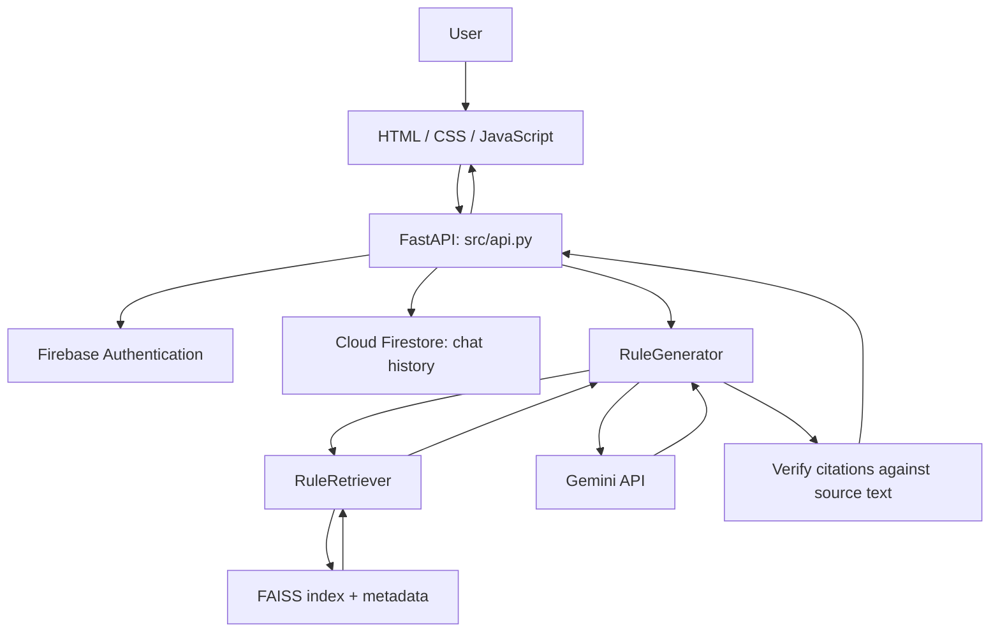

# Bhumi Vikas Sahayak

**A source-grounded, conversational RAG assistant for the Madhya Pradesh Bhumi Vikas Rules, 2012.**

Bhumi Vikas Sahayak helps users find, understand, and discuss provisions of the **Madhya Pradesh Bhumi Vikas Rules, 2012**, using a consolidated source document dated **6 March 2025**. Rather than answering solely from a language model's general knowledge, the application retrieves relevant rule passages, asks Google's Gemini model to explain them, and displays supporting rule citations.

The application combines a custom responsive web interface, a Python/FastAPI backend, multilingual semantic search, and Firebase Authentication/Firestore for user accounts and saved conversations.

> [!IMPORTANT]
> **Document coverage:** The bundled rulebook is consolidated only through **6 March 2025**. Later changes, including the **28 August 2026 amendment**, are not included in this dataset. This is an **informational research assistant**, not a building-permission approval system, a substitute for official documents, or professional legal advice.

## Features

- **Grounded answers:** Retrieves passages from the Bhumi Vikas Rules before generating a response.
- **English and Hindi queries:** Uses a multilingual embedding model and Gemini for bilingual interaction.
- **Rule citations:** Shows rule numbers, quoted source text, and PDF page ranges where available.
- **Conversation-aware follow-ups:** Uses recent messages from the current saved conversation to interpret questions such as *“Explain that further.”*
- **Firebase account system:** Email/password registration, sign-in, sign-out, and password-reset support.
- **Personalized profiles:** Stores a display name in Firebase Authentication and shows the user's initials in the interface.
- **Saved conversations:** Keeps the **10 most recently updated conversations per account** in Firestore.
- **Responsive custom UI:** HTML/CSS/JavaScript frontend with light/dark themes, mobile navigation, and an animated CSS 3D `भू` logo introduction.
- **Clear uncertainty handling:** Can report when a provision is not found or when numerical information requires checking against the official PDF.

## Technology stack

| Layer | Technology | Purpose |
| --- | --- | --- |
| Frontend | HTML, CSS, vanilla JavaScript | Custom chatbot interface, themes, animation, source display |
| Backend | Python, FastAPI, Uvicorn | Web server, application API, session validation |
| Data preparation | Python, JSONL | Structure and chunk the rulebook |
| Embeddings | Sentence Transformers | Create multilingual vector representations |
| Embedding model | `paraphrase-multilingual-MiniLM-L12-v2` | Semantic retrieval in English/Hindi |
| Vector index | FAISS (`IndexFlatIP`) | Similarity search over normalized embeddings |
| Answer generation | Google Gemini (`google-genai`) | Source-conditioned explanations and structured responses |
| Validation | Pydantic + source-quote matching | Response schema and citation checking |
| Authentication | Firebase Authentication | Email/password accounts and server-issued session cookies |
| Persistence | Cloud Firestore (Firebase Admin SDK) | Per-user conversation history |
| Configuration | `python-dotenv` | Load local environment variables |

## Architecture



The **retriever finds evidence**; Gemini **explains the retrieved passages**; the **citation validator checks whether quoted text occurs in the source**. A valid quotation does **not** by itself guarantee that every legal interpretation is correct.

### RAG pipeline

1. **Ingestion (`src/ingestion.py`):** Reads rule records from `data/bhumi_vikas_rules.jsonl` and splits long provisions into rule-aware chunks while preserving original source text.
2. **Embeddings (`src/embeddings.py`):** Converts overlapping token windows into normalized multilingual vectors and builds the FAISS index. Windows retain links to their original rule chunks.
3. **Retrieval (`src/retriever.py`):** Searches the vector index, maps matches to original passages, and boosts explicitly mentioned rule numbers.
4. **Generation (`src/generator.py`):** Supplies the question, relevant rule passages, and—where applicable—recent conversation context to Gemini.
5. **Verification:** Checks the structured response and source quotations before returning the answer and citations.
6. **Persistence (`src/api.py`):** Associates a saved conversation with the authenticated user's Firebase UID.

The generator also uses targeted rule retrieval for certain broad topics, such as building-height provisions. These are **source retrieval aids**, not independent legal rules.

## Project structure

```text
PDF-RAG/
├── README.md
├── requirements.txt
├── .gitignore
├── .env                            # Local only; never commit
├── frontend/
│   ├── index.html                  
│   ├── style.css                  
│   └── script.js                  
├── src/
│   ├── ingestion.py                
│   ├── embeddings.py               
│   ├── retriever.py                
│   ├── generator.py               
│   └── api.py                      
└── data/
    ├── DATA_DICTIONARY.md
    ├── bhumi_vikas_rules.jsonl
    ├── bhumi_vikas_rules_fulltext_by_page.txt
    ├── bvn06032025E.pdf           
    ├── bvn06032025H.pdf           
    └── processed/                  # Generated locally; ignored by Git
        ├── chunks.jsonl
        ├── rules.faiss
        └── index_metadata.json
```

`data/processed/` is generated rather than version-controlled. The first-time setup below explains how to recreate it.

## Getting started

### 1. Prerequisites

- **Python 3.12 (64-bit recommended on Windows)** and Git.
- A **Google Gemini API key** from [Google AI Studio](https://aistudio.google.com/).
- A **Firebase project** with **Email/Password** authentication and **Cloud Firestore** enabled.
- A **Firebase Admin service-account credential** for the backend.
- The source files in `data/` as shown above.

> The Firebase *Web API key* identifies the Firebase project and is generally not treated as a secret. This application sends authentication requests from Python, so that configuration is intentionally kept out of the browser. The **service-account JSON private key is sensitive** and must never be included in frontend files or committed to Git.

### 2. Clone and create a Python environment

```powershell
git clone https://github.com/KG0009/PDF-RAG.git
cd PDF-RAG
python -m venv .venv
.\.venv\Scripts\Activate.ps1
python -m pip install --upgrade pip
python -m pip install -r requirements.txt
```

For macOS/Linux, activate the environment with `source .venv/bin/activate`.

### 3. Configure Firebase

1. Open the [Firebase Console](https://console.firebase.google.com/) and select your project.
2. Under **Build → Authentication → Sign-in method**, enable **Email/Password**.
3. Under **Build → Firestore Database**, create a database if one does not already exist.
4. Open **Project settings → Service accounts → Firebase Admin SDK** and generate a service-account key for local development.
5. Save the downloaded JSON **outside the repository**, for example `C:/secure/firebase-service-account.json`, and protect it as a private credential.
6. Under **Project settings → General**, find your Firebase project's Web API key for `FIREBASE_WEB_API_KEY`.

In an appropriately configured Google Cloud deployment, prefer an attached service identity/application-default credentials over distributing a JSON private key.

### 4. Configure environment variables

Create `.env` in the project root:

```dotenv
# Server-side Gemini API access
GEMINI_API_KEY=YOUR_GEMINI_API_KEY

# Firebase Auth REST API configuration (used by Python)
FIREBASE_WEB_API_KEY=YOUR_FIREBASE_WEB_API_KEY

# Private Firebase Admin credentials; keep JSON outside this repository
GOOGLE_APPLICATION_CREDENTIALS=C:/secure/firebase-service-account.json

# For local HTTP development only; use true behind HTTPS in production
COOKIE_SECURE=false

# Optional: choose model IDs available to your Gemini API project.
# Verify names using the current official Gemini model documentation.
# GEMINI_MODEL=YOUR_SUPPORTED_PRIMARY_MODEL
# GEMINI_BACKUP_MODEL=YOUR_SUPPORTED_BACKUP_MODEL
```

If you prefer, `GEMINI_API_KEY` can be set in the **same PowerShell session** that launches Uvicorn:

```powershell
$env:GEMINI_API_KEY="YOUR_GEMINI_API_KEY"
```

A variable set this way is not automatically retained in new PowerShell sessions. `python-dotenv` loads `.env` values without overwriting existing shell variables by default.

**Never commit `.env` or the Firebase service-account JSON.** Confirm your `.gitignore` covers them:

```gitignore
.env
.env.*
!.env.example
.venv/
__pycache__/
*.pyc
data/processed/
*service-account*.json
```

If a private key has ever been committed, **revoke/rotate it**; deleting the file from a later commit does not remove it from Git history.

### 5. Generate the local RAG index

Run these commands from the repository root:

```powershell
python src/ingestion.py
python src/embeddings.py
```

The first command writes `data/processed/chunks.jsonl`. The second produces:

```text
data/processed/rules.faiss
data/processed/index_metadata.json
```

The embedding model may need to be downloaded during the first run. The index should be regenerated if the source chunks, source data, or embedding configuration changes.

### 6. Run the application

```powershell
python -m uvicorn src.api:app --reload
```

Open **http://127.0.0.1:8000/**. Register an account or sign in, then ask a question about the Rules. Uvicorn serves both the frontend and API on the same origin.

Useful development URLs:

- **Web app:** `http://127.0.0.1:8000/`
- **Interactive API docs:** `http://127.0.0.1:8000/docs`
- **Health endpoint:** `http://127.0.0.1:8000/api/health`
- **Source PDF served by the API:** `http://127.0.0.1:8000/source/english.pdf`

> `--reload` and `COOKIE_SECURE=false` are for local development. They are **not** production deployment settings.

## How to use

1. **Create an account** with a full name, email address, and password, or sign in to an existing account.
2. **Ask a question**, such as *“What is Floor Area Ratio (FAR)?”* or *“Explain Rule 65 on building height.”*
3. **Read the answer and citations.** Expand source references to inspect the rule number, quotation, and associated PDF page range.
4. **Ask follow-up questions** in the same conversation, such as *“Explain that in Hindi.”* Recent messages help the assistant preserve the topic.
5. **Open, start, or delete conversations** from the sidebar. Up to 10 conversations per account are retained.
6. **Update your display name** in the profile controls; the interface uses your initials as the user avatar.

## API overview

The web client communicates with FastAPI using same-origin requests. Authentication relies on an **HTTP-only Firebase session cookie**, issued by the backend after email/password verification.

| Method | Endpoint | Purpose | Login required |
| --- | --- | --- | --- |
| `GET` | `/` | Serve the web interface | No |
| `GET` | `/api/health` | Health check | No |
| `GET` | `/source/english.pdf` | Serve bundled English rulebook | No |
| `POST` | `/api/auth/register` | Register with full name, email and password | No |
| `POST` | `/api/auth/login` | Sign in and create session cookie | No |
| `POST` | `/api/auth/logout` | End browser session | Session cookie |
| `GET` | `/api/auth/me` | Fetch signed-in account profile | Yes |
| `PATCH` | `/api/auth/profile` | Update display name | Yes |
| `POST` | `/api/auth/password-reset` | Request password-reset email | No |
| `POST` | `/api/ask` | Generate a source-grounded answer | Yes |
| `GET` | `/api/chats` | List saved conversation summaries | Yes |
| `GET` | `/api/chats/{chat_id}` | Load one conversation | Yes |
| `POST` | `/api/chats` | Save or update a conversation | Yes |
| `DELETE` | `/api/chats/{chat_id}` | Delete a conversation | Yes |

### Example question payload

```json
{
  "question": "Explain the rules relating to building height.",
  "chat_id": null
}
```

For an existing saved conversation, `chat_id` is its 32-character identifier. The backend retrieves up to **six recent messages** for follow-up context from Firestore; the browser does not supply authoritative conversation history.

An answer has the following general shape:

```json
{
  "status": "answered",
  "answer": "Source-grounded explanation returned by Gemini...",
  "citations": [
    {
      "rule": "65",
      "title": "Height limit",
      "quote": "An exact extract from the indexed rule text...",
      "page_start": 1,
      "page_end": 2
    }
  ],
  "model_used": "MODEL_ID_USED",
  "source_version": "2025-03-06"
}
```

**This is a schema illustration, not a real answer or authoritative page reference.** Actual quotations and page ranges come from the indexed source.

Possible response statuses are `answered`, `not_found`, and `needs_verification`.

## Firebase data model

```text
Cloud Firestore
└── chat_history
    ├── <firebase-user-uid-A>
    │   ├── chats: [up to 10 conversations]
    │   └── updatedAt: timestamp
    └── <firebase-user-uid-B>
        ├── chats: [up to 10 conversations]
        └── updatedAt: timestamp
```

A saved conversation includes its ID, title, messages, creation time, and last-updated time. Each user's Firestore document is identified by their **Firebase Authentication UID**.

Current storage limits include **10 conversations per account**, **60 messages per saved conversation**, and an application-level size guard of about **700 KB** per history document. When an eleventh conversation is saved, the least recently updated one is removed from the stored list.

Firebase Admin SDK operations run on the backend and bypass client-side Firestore Security Rules. The **FastAPI backend must therefore enforce authentication and ownership**, which it does by looking up documents using the verified session's UID. Do not expose the Admin credential to the browser.

## Security and deployment notes

The application includes several protective measures, but **the current code should be treated as a development/prototype deployment**, not a fully hardened public service:

- Gemini and Firebase Admin credentials are read only on the server; frontend JavaScript does not contain them.
- Firebase login sessions use `HttpOnly`, `SameSite=Strict` cookies. The current implementation uses a **five-day** session lifetime.
- Protected endpoints verify the Firebase session and use the authenticated UID to access chats.
- The API checks browser request origins for state-changing operations and includes basic in-memory rate limiting.
- A public deployment should use **HTTPS**, set `COOKIE_SECURE=true`, configure trusted proxy/origin behavior, and implement durable/shared rate limiting and monitoring.
- Consider email verification, account-abuse prevention, credential rotation, data-retention policies, and deployment-specific access controls before allowing untrusted public traffic.
- **Do not** launch the production application with `--reload` or commit any environment files, private service-account data, or tokens.

## Known limitations

- **Source freshness:** The indexed rulebook is consolidated only through **6 March 2025**. Subsequent amendments are not included.
- **PDF tables:** Complex tables flattened during extraction can make numerical values, FAR limits, setbacks, and building-height calculations difficult to verify reliably.
- **Page precision:** Page ranges in the current chunk metadata may cover an **entire rule**, not the exact page containing a quoted sentence.
- **Citation limits:** Confirming that a quote exists in the source is not the same as confirming every part of an interpretation, applicability assessment, or calculation.
- **Conversational context:** Only recent messages from the selected saved conversation are used; context is not shared across different conversations.
- **Model availability:** Gemini model IDs, quotas, pricing, and availability depend on the API project and may change. Configure supported models as appropriate.
- **Not an approval tool:** All decisions affecting building permits or regulatory compliance require verification against current official rules and the competent authority.

## Troubleshooting

| Symptom | What to check |
| --- | --- |
| `Gemini API key not found` | Set `GEMINI_API_KEY` in `.env` or in the terminal that starts Uvicorn. |
| Gemini `503 UNAVAILABLE` | Temporary provider overload; check primary/backup model availability and retry later. |
| Gemini `404` or model error | Verify `GEMINI_MODEL` and `GEMINI_BACKUP_MODEL` against model IDs available to your API project. |
| Gemini `429` | API quota/rate limit, or the application's local request limit. |
| Firebase credential error | Confirm `GOOGLE_APPLICATION_CREDENTIALS` points to an existing private JSON file for the right Firebase project. |
| Registration/login fails | Enable **Email/Password** under Firebase Authentication; confirm `FIREBASE_WEB_API_KEY`. |
| Firestore save fails | Confirm the Firestore database exists, the server has sufficient permissions, and the document is within size limits. |
| `Missing file: ... rules.faiss` | Run `python src/ingestion.py`, then `python src/embeddings.py`. |
| Page loads without styling | Confirm `/static/style.css` and `/static/script.js` return HTTP 200; hard-refresh the browser. |
| A follow-up loses context | Continue in a saved conversation; the `/api/ask` request should include its `chat_id`. |
| Answer says `needs_verification` | Check the relevant rule and its tables directly in the official PDF. |

## Repository

[KG0009/PDF-RAG](https://github.com/KG0009/PDF-RAG)
